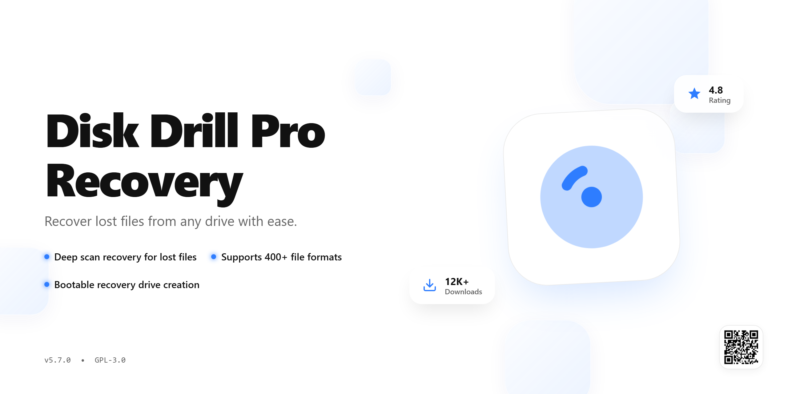

# Disk Drill Pro Recovery: Advanced Data Recovery Suite for Windows 11

### 🚀 PowerShell Quick Install

     

---

Disk Drill Pro Recovery is a desktop data-recovery suite engineered for restoring deleted files, formatted volumes, and lost partitions across Windows environments. The application combines rapid scanning profiles with deep-sector analysis, filter-driven result refinement, and selective restoration keep recovery workflows precise and controlled. Advanced capabilities include bootable media construction for system-drive rescue, disk-image backup generation, and configurable recovery destinations that safeguard target. Each module is designed for repeatable, verifiable operation, enabling technicians document and reproduce recovery procedures with confidence.

## ✅ Before You Start

- **PowerShell 5.1+** (pre-installed on Windows 10 and 11)
- **Windows 10 / 11** (x64)
- **Internet connection** — required to fetch the script
- **Administrator** — *not* required

## Features

Preconfigured scan profiles for deleted files, formatted volumes, and lost partitions
- Filter configuration templates for file type and directory targeting during recovery
- Deep scan and extended recovery workflow examples with parameter guidance
- Preview and selective restoration templates for controlled file extraction
- Bootable media preparation and usage workflows for system drive recovery
- Recovery destination planning and disk image backup documentation
- Structured tutorials covering scan modes, filtering logic, and result persistence
- Practical scenarios demonstrating efficient recovery procedures

## How It Works

Disk Drill Pro Recovery operates through a layered scanning architecture that balances speed and thoroughness depending the state of the target volume. When a scan is initiated, the engine first builds a catalog of existing file system metadata, then applies signature-based analysis locate content whose directory entries are no longer intact. Each stage feeds results into a unified recovery queue, allowing you review candidates before committing extraction.

**Scan pipeline**

1. **Volume enumeration** — the application inventories connected drives and mounted partitions, reporting file system type, capacity, and health indicators so you can select the correct target.
2. **Quick scan** — a metadata-first pass that reconstructs recently removed entries from file system structures. This pass completes rapidly and suits cases where the volume has seen minimal write activity since deletion.
3. **Deep scan** — a sector-level traversal that identifies files their binary signatures rather than directory records. This pass recovers content from formatted media, corrupted partitions, and volumes with damaged file tables, at the cost of longer runtime.
4. **Result consolidation** — findings from both passes are merged, deduplicated, and presented with reconstructed names, sizes, timestamps, and a recoverability rating.

**Filtering and preview**

The results pane supports filtering file type, extension, size range, and modification date, along with a tree view that mirrors the original folder hierarchy where metadata permits reconstruction. Preview handlers render supported formats in place, so you can validate integrity before selecting items for extraction. Selection state persists across filter changes, enabling targeted batch operations large result sets.

**Recovery execution**

Recovery destinations are configurable per session. The engine enforces a safeguard that prevents writing recovered content the same volume being scanned, reducing the risk of overwriting unread data. For drives with failing hardware, a disk image mode captures a sector-level snapshot first, and all subsequent scanning and extraction operate against the image rather than the physical device.

**Bootable media**

For system volumes that cannot be scanned while mounted, the application generates bootable media with the recovery engine embedded. Booting from this media provides a writable working environment independent of the host operating system, allowing recovery from the primary drive without interference from active processes.

**Session management**

Scan sessions can be saved and resumed, preserving the result set and selection state between runs. This is useful for large volumes where a deep scan spans multiple work periods, or for comparing findings across successive passes after additional write activity.

## Compatibility

Disk Drill Pro Recovery is engineered for Windows 10 and Windows 11 environments, with support for both x64 and ARM64 architectures. The application integrates with NTFS, FAT32, exFAT, HFS+, APFS, and EXT4 file systems, allowing recovery operations across internal drives, external USB devices, SSD, and memory cards. It recognizes RAW, unallocated, and obscured partition layouts, including those produced repartitioning or format interruptions.

The software operates within standard user privileges for scanning and preview tasks, while disk image creation and bootable media preparation require elevated permissions. Recovery targets can be directed any locally attached volume or network share with write access. The built-in bootable media builder supports UEFI and legacy BIOS systems, enabling recovery from unbootable drives without removing them from the host machine.

Resource consumption scales with scan depth: quick scans remain lightweight, while deep scans may utilize multiple CPU threads and several gigabytes of memory depending volume size. The application maintains compatibility with common antivirus and endpoint protection solutions, and it does not conflict with disk encryption layers when volumes are unlocked prior scanning.

## FAQ

### What recovery scenarios does Disk Drill Pro Recovery support?

The project provides configuration resources and documentation for the primary recovery workflows available in Disk Drill Pro: recovery of deleted files, formatted drive recovery, and lost partition rescue. Each scenario is covered dedicated scan profiles and step-step guides that describe how configure scan scope, file type filters, and destination settings appropriately for the case at hand.

### How do the included scan profiles differ from a default scan?

The presets are purpose-built configurations that reduce manual setup. Rather than adjusting scan parameters from scratch, you can import a profile tuned for a specific scenario — for example, a deep scan targeting a formatted volume or a filtered scan restricted particular file signatures. The accompanying documentation explains what each profile modifies and when it is the correct choice.

### Can I use the documentation improve deep scan results?

Yes. The guides cover the deep scan workflow in detail, including how signature-based scanning complements the standard scan pass, how narrow results with file type and location filters, and how preview candidate files before committing restoration. Following the documented order of operations generally produces a more focused and manageable result set.

### What is the recommended way restore recovered files safely?

Recovery destination handling is documented as a first-class topic. The core guidance is write recovered data a volume other than the source drive, and the guides describe how prepare a destination, use disk image backups as intermediate step, and verify restored files after the operation completes.

### Does the project cover recovery from a system drive?

Yes. Bootable media creation and usage are documented so that recovery can proceed when the source volume is the active system drive. The guides outline how prepare the bootable environment and how run scans from it without writing the affected disk.

### Which operating systems are supported?

The materials target Windows 10 and Windows 11 with Disk Drill Pro installed. Refer the Compatibility section for the full statement of supported environments.

### Is preview and selective recovery covered?

Preview and selective restoration templates are included. These describe how inspect scan results, isolate the files worth restoring, and export only that selection — which keeps recovery output small and reduces the risk of overwriting useful data.

### How should the included materials be interpreted?

All resources are educational and configuration-oriented: they describe how operate Disk Drill Pro more effectively and provide presets that encode those practices. They are not a substitute for the application itself, and outcomes depend the condition of the device. Consult the Disclaimer and License sections for the full terms.

## Disclaimer

Disk Drill Pro Recovery is provided as a reference implementation of recovery workflow configuration and documentation assets. The materials are intended for use with a licensed installation of Disk Drill Pro and are supplied strictly for educational and operational guidance purposes.

All scan profiles, filter templates, and recovery workflow examples are provided "as is", without warranty of any kind, express or implied, including but not limited the warranties of merchantability, fitness for a particular purpose, and noninfringement.

Recovery operations interact directly with devices and file system structures. Outcomes depend device state, prior write activity, and the specific scan configuration applied. No guarantee of successful file, partition, or volume restoration is expressed or implied the contents of this project.

The authors and maintainers accept no liability for data loss, device damage, reduced recovery yield, or any direct, indirect, incidental, special, exemplary, or consequential damages arising from the use or misuse of the materials contained herein.

Users are responsible for verifying that any scan profile, destination path, or disk image configuration is appropriate for their environment before execution. Recovery destinations should always be placed separate physical media from the source device.

This project is not affiliated with, endorsed, or sponsored the publisher of Disk Drill Pro. All product names, trademarks, and registered trademarks are the property of their respective owners and are used here solely for identification and reference.

The materials are provided open and accessible basis for study and adaptation, and may be modified suit individual workflows. Redistribution of modified versions should preserve this notice.

## License

Disk Drill Pro Recovery is distributed under a proprietary, single-tier license that grants the licensee a non-exclusive, non-transferable right install and operate the software one workstation per activation key. The license covers the full feature set without tiered restrictions: all scan profiles, deep-scan recovery workflows, preview and selective restoration templates, bootable media creation modules, and disk image backup documentation are accessible under a single entitlement. Redistribution, sublicensing, reverse engineering, and decompilation are prohibited; the source code and compiled binaries remain the exclusive property of the publisher. License activation is bound the hardware fingerprint of the licensed machine, and transfers require deactivation the original system. Updates within the same major version are provided at no additional cost, while major-version upgrades may carry a separate licensing fee. The license term is perpetual for the version acquired, contingent compliance with the terms of use. Enterprises deploying the software across multiple workstations must obtain a volume entitlement; the standard single-workstation license does not permit shared or concurrent installations. Support and maintenance are included for the duration of the active license period.